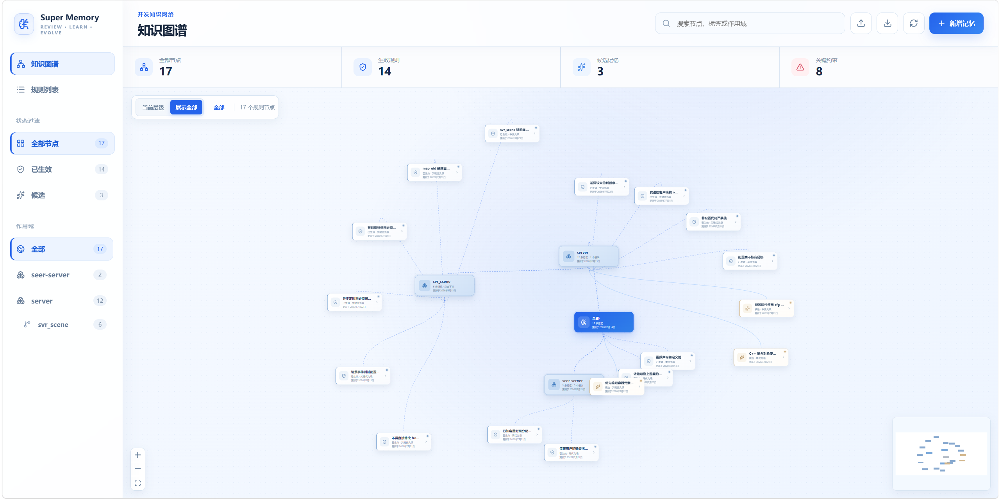
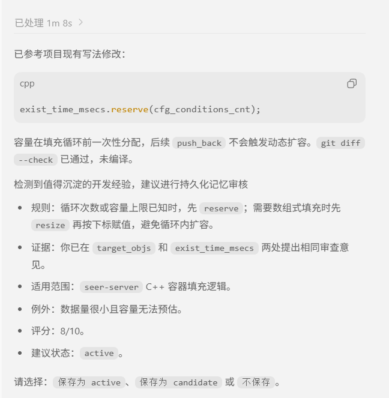
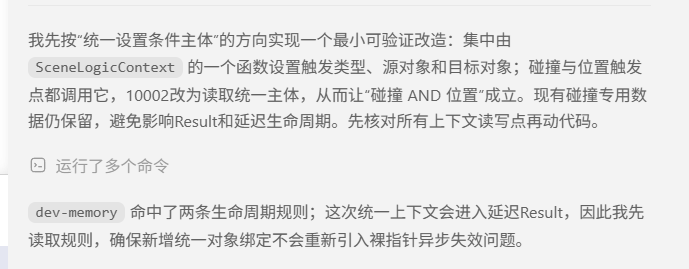

# Super Memory

Super Memory 是一套持久化记忆工具。它把人工代码审查、Git 差异、测试失败和故障证据沉淀为可审核、可检索、可持续演化的开发规则。

它包含：

- 一个负责检索、复盘、审核和维护开发规则的 Codex Skill；
- 一套确定性的 Python 命令行工具；
- 一个与 Codex 和命令行共用同一份数据的本地可视化管理台。

> Super Memory 是社区项目，并非 OpenAI 官方项目。



管理台以作用域和分类为中心展示开发规则。可以按层级下钻，区分生效规则与候选记忆，并完成搜索、新增、编辑、删除、导入和导出。图谱、规则列表、Codex Skill 与命令行直接读写同一份规则数据。

## 它解决什么问题

普通对话可以记住当前上下文，却很难稳定管理这些长期开发经验：

- 哪些代码审查意见已经被确认；
- 一条经验适用于全局、项目还是具体模块；
- 哪些规则已经生效，哪些仍需观察；
- 规则为什么产生、有哪些证据和例外；
- 旧规则何时被废弃或被新规则替代。

Super Memory 将这个过程组织成闭环：

```text
编码前检索生效规则
        ↓
Codex 生成或修改代码
        ↓
人工审查 / 测试失败 / 故障证据
        ↓
检测是否具有通用性并生成中文记忆审核草案
        ↓
用户选择 active / candidate / 不保存（直接忽略即可）
        ↓
后续任务再次检索、应用和校验
```

## 从一次修正形成可审核记忆



当人工审查、测试结果或故障证据揭示了可复现问题时，Super Memory 不会直接写入规则库，而是先让 Codex 生成中文审核草案。草案包含规则、证据、适用范围、例外、评分和建议状态，并明确提供三个选择：

- `保存为 active`：立即作为生效规则参与后续编码；
- `保存为 candidate`：保留为候选经验，只用于提示和继续观察；
- `不保存`：本次经验不进入持久化规则库。

只有用户明确确认后，规则才会落库。

## 编码前自动检索



配置自动调用后，Codex 在代码生成、修改、调试或审查开始前，会按语言、技术、项目、模块和操作关键词检索最相关的生效规则。命中的规则进入本次任务上下文，候选规则只作提示，不会直接约束代码生成。

检索支持 `C++/cpp/cxx` 等语言别名和中文句子。项目、模块、语言和技术可通过独立参数过滤，项目名和模块名不会作为相关度加分项。`search` 一次返回完整要求、触发条件、例外、冲突关系及规则来源。

任务结束前，Codex 还会依据命中的规则做一次自检；如果新的人工纠正具有充分证据，再进入记忆审核流程。

## 与 Codex 自身持久化能力配合

Codex 的 `AGENTS.md`、Memories 和 Skills 是互补能力：`AGENTS.md` 提供持久指令，Memories 延续有用上下文，Skills 封装可复用流程。Super Memory 使用这三层能力协作，但不会把同一批开发规则复制成多份。

| 层级 | 作用 | 建议保存的内容 |
| --- | --- | --- |
| Codex Memories | 延续跨任务的有用上下文 | 轻量背景、稳定偏好和工作上下文 |
| `AGENTS.md` | 让仓库或开发者级指令持续生效 | 要求编码任务自动调用 Super Memory |
| Super Memory Skill | 执行确定性的记忆工作流 | 检索、复盘、审核、保存、自检和生命周期维护 |
| Super Memory 规则库 | 结构化开发规则的唯一事实源 | `active`、`candidate`、`archive` 规则及证据历史 |

推荐边界：

- Codex 原生 Memories 可以正常开启，用于延续一般上下文；
- `AGENTS.md` 负责稳定触发 Super Memory；
- 经审核的开发规则只保存在 Super Memory 规则库；
- 不把同一规则同时写入 Codex Memories、`MEMORY.md` 或其他笔记，避免出现两套不一致的规则。

如果使用 Codex CLI，可以通过 `/memories` 配置原生记忆的注入与生成。开启或关闭它都不会改变 Super Memory 的规则数据；两者没有同步关系。

Codex 对这些能力的官方定位可参考 [Customization](https://learn.chatgpt.com/docs/customization/overview)。

## 安装到 Codex

在 Codex 中发送下面这句话：

```text
使用 $skill-installer 从 GitHub 仓库 leozeng-coder/super-memory 的 skills/super-memory 子目录安装 Super Memory
```

安装完成后，Skill 会在下一轮任务中可用。首次初始化默认规则库：

```powershell
python "$HOME/.codex/skills/super-memory/scripts/memory.py" init
```

默认数据目录是 `~/.super-memory`。如需使用其他目录，请让 Codex、命令行和管理台都设置同一个 `SUPER_MEMORY_HOME`。

### 安装不会自动修改 Codex 记忆

安装和初始化只会产生以下变更：

- `$skill-installer` 将 Skill 文件安装到 Codex 的 Skills 目录；
- `init` 在 `~/.super-memory` 或 `SUPER_MEMORY_HOME` 指定的位置创建 Super Memory 规则库；
- 管理台和命令行只读写这套独立规则库。

Super Memory 不会自动修改 Codex 原生的 `~/.codex/memories/`、`MEMORY.md`，也不会访问其他开发工具的持久化记忆。它同样不会自动修改用户已有的 `AGENTS.md`；需要自动调用时，请按下一节手动追加配置。

## 配置自动调用

根据需要选择一种配置方式：

- 全局生效：手动编辑 `~/.codex/AGENTS.md`；Windows 默认位置是 `C:\Users\<你的用户名>\.codex\AGENTS.md`；
- 单个项目生效：手动编辑该项目根目录的 `AGENTS.md`。

如果文件不存在，可以新建；如果已经存在，请保留原内容并在末尾追加下面这段，不要覆盖用户已有指令：

```md
进行代码生成、修改、调试或审查任务时，自动隐式使用全局 `super-memory` Skill。所有开发持久化记忆相关规范，包括检索、复盘、审核、保存和生命周期管理，均以该 Skill 的 `SKILL.md` 为唯一依据。
```

保存后开启一个新的 Codex 任务进行验证，例如直接提出普通开发请求：

```text
请帮我修改这段 C++ 容器填充逻辑，并检查是否符合项目已有开发规则。
```

如果配置生效，Codex 会在编码前调用 Super Memory 检索相关 `active` 规则；没有匹配规则时会安静继续，不会产生无意义提示。

### 配置后会达到什么效果

- 开始代码生成、修改、调试或审查前，Codex 会先按语言、技术、项目、模块和操作检索相关 `active` 规则；
- 只加载匹配度最高的规则，避免把整个规则库塞入任务上下文；
- 在不冲突用户当前明确指令的前提下，`active` 规则可以约束本次实现，`candidate` 只用于提示，不会直接约束代码；
- 没有匹配规则时安静继续，不影响正常编码；
- 完成修改后，Codex 会依据命中的规则自检；
- 遇到有充分证据的新经验时，Codex 先展示中文审核草案，只有用户明确选择 `active` 或 `candidate` 后才保存；
- 整个过程只读写 Super Memory 规则库，不会修改 Codex 原生 Memories 或其他工具的持久化记忆。

### 不修改 `AGENTS.md` 时如何使用

不配置 `AGENTS.md` 也可以使用 Super Memory。Skill 的描述允许 Codex 根据任务语义隐式选择，但如果希望确保本次任务一定调用，请在请求中显式写出 `$super-memory`：

```text
使用 $super-memory 检索与当前 C++ 修改相关的生效规则。
```

```text
使用 $super-memory 复盘这次人工代码审查，并生成中文记忆审核草案。
```

如果要明确要求保存，请先审核 Codex 给出的草案，再回复“保存为 active”或“保存为 candidate”。未作明确选择时，Super Memory 不会落库。

## 启动可视化管理台

如果需要图谱、规则编辑以及导入导出功能，克隆完整仓库：

```powershell
git clone https://github.com/leozeng-coder/super-memory.git
cd super-memory
python ./skills/super-memory/scripts/memory.py init
.\start-super-memory.cmd
```

首次启动会安装 Web 依赖。页面与本地 API 默认只监听本机回环地址；未设置自定义数据目录且源码根目录没有本地配置时，使用 `~/.super-memory`。

如果源码检出根目录已经有 `memory.config.json`，或设置了 `SUPER_MEMORY_HOME`，会优先使用相应目录。请核对启动输出和检索结果中的 `memory_root`，确保管理台与已安装的 Skill 指向同一个规则库。

也可以在 PowerShell、macOS 或 Linux 中分别运行 `./start-super-memory.ps1`、`./start-super-memory.sh`，或直接执行 `node ./start-web.mjs`。

如需把规则数据保存在自定义目录，启动 Codex 和管理台前设置相同的环境变量：

```powershell
$env:SUPER_MEMORY_HOME = "D:\my-super-memory"
python ./skills/super-memory/scripts/memory.py init
.\start-super-memory.cmd
```

## 工作方式

Super Memory 将以下规则 JSON 作为唯一事实源：

```text
graph/rules/active/
graph/rules/candidate/
graph/rules/archive/
```

Codex、命令行和可视化管理台直接读写同一个记忆目录。`indexes/rules.json` 只是可以随时重建的派生索引，`graph/rules/trash` 是不参与检索的本地回收区。

规则数据目录按以下顺序确定：

1. 命令行参数 `--root`；
2. 环境变量 `SUPER_MEMORY_HOME`；
3. 已经包含 `memory.config.json` 的源码检出根目录；
4. 用户目录下的 `~/.super-memory`。

## 命令行用法

唯一入口为 `scripts/memory.py`。下面的命令在仓库根目录运行；指定数据目录时，在子命令前加 `--root <目录>`。

```powershell
# 显示数据目录；info 不会初始化
python ./skills/super-memory/scripts/memory.py info

# 初始化、校验与重建索引
python ./skills/super-memory/scripts/memory.py init
python ./skills/super-memory/scripts/memory.py validate
python ./skills/super-memory/scripts/memory.py reindex

# 读取完整规则要求和例外
python ./skills/super-memory/scripts/memory.py search `
  --query "异步回调 shared_ptr 生命周期" `
  --project my-project `
  --module my-module `
  --language cpp
```

项目和模块须替换为实际 ID。未提供的作用域不会自动推断；指定项目但模块未知时，只返回项目及更广范围的规则。

| 参数 | 用途 |
| --- | --- |
| `--project` | 当前项目 ID |
| `--module` | 当前模块，必须同时提供项目；可重复 |
| `--language` / `--technology` | 语言或技术过滤；可重复 |
| `--limit` | 普通匹配规则上限，默认 8 |
| `--max-chars` | JSON 输出字符预算，默认 16000，最小 512 |
| `--include-candidates` | 复盘时同时查找候选规则；候选规则不约束代码 |

`search` 固定返回完整要求、例外、来源、匹配依据和内容版本号 `revision`。`omitted_count` 与 `warnings` 说明因预算遗漏的规则；正文和例外不会截断。经用户确认后可设置 `trigger.always_apply: true`，此类 active 规则在完整上下文确认适用后不受普通数量上限影响，字符预算不足时报错。

### 新增、更新与删除

规则由 [Schema](./skills/super-memory/assets/memory-rule.schema.json) 定义，程序直接读取这一份定义进行校验。规则 JSON 的 `status` 决定生效、候选、弃用或归档状态；审核步骤见 [Skill](./skills/super-memory/SKILL.md)。

```powershell
# 新增已审核的完整规则
python ./skills/super-memory/scripts/memory.py create `
  --input "./rule-draft.json" --reason "用户确认新增规则"

# 读取完整规则和内容版本号
python ./skills/super-memory/scripts/memory.py get RULE-EXAMPLE

# 更新时必须提供读取时的 revision
python ./skills/super-memory/scripts/memory.py update RULE-EXAMPLE `
  --revision "<读取时的 revision>" `
  --input "./rule-draft.json" --reason "用户确认更新规则"

# 删除也检查版本，并将规则移入回收区
python ./skills/super-memory/scripts/memory.py delete RULE-EXAMPLE `
  --revision "<读取时的 revision>" --reason "用户确认删除规则"
```

- 新增与更新是独立命令。已有 ID 不能用 `create` 覆盖，`update` 和 `delete` 均强制检查内容版本。
- `revision` 是完整规则内容的哈希；即使文件被手工修改且更新时间未变，也能发现冲突。冲突后重新读取、合并，再保存。
- 更新按证据 ID 合并历史；旧证据不可覆盖，纠正时用新 ID 追加说明。保存不会刷新表示实践验证时间的 `last_validated_at`。
- CLI 接受 `--input <文件>` 或标准输入 JSON，成功输出 JSON；业务失败返回非零退出码，并在标准错误输出 `{"error":{"code":"...","message":"..."}}`。

### 快照与导入导出

```powershell
# 一次读取完整规则、版本号与作用域
python ./skills/super-memory/scripts/memory.py list

# 直接写入 UTF-8 JSON 文件
python ./skills/super-memory/scripts/memory.py export --output "./rules-export.json"

# 默认跳过已有 ID；replace 表示确认更新同 ID 规则
python ./skills/super-memory/scripts/memory.py import `
  --input "./rules-export.json" --conflict skip --reason "用户确认导入规则"
```

导入先校验整批数据，再一次提交规则和作用域；更新已有规则仍保留证据历史。所有写入由同一个业务服务执行。文件锁串行化读写，事务日志记录原数据，操作异常会恢复；进程中断后，下次访问会先恢复未完成事务。

## 实现结构

```text
skills/super-memory/
├── SKILL.md
├── assets/memory-rule.schema.json
└── scripts/
    ├── memory.py                 命令入口
    └── super_memory/
        ├── cli.py                参数和 JSON 输入输出
        ├── domain.py             Schema 校验、证据合并和内容版本
        ├── repository.py         文件锁、原子写入和事务恢复
        ├── search.py             作用域、匹配、排序和输出预算
        └── service.py            新增、更新、删除及批量操作
```

管理台通过 `web/memory-client.mjs` 异步调用同一 CLI，`web/local-api.mjs` 负责 HTTP。列表返回 `records` 与 `scopes` 的一致快照；单条记录为 `{rule, revision}`。新增和更新请求使用 `{rule}`，更新及删除必须在 `If-Match` 中携带版本号，版本冲突返回 HTTP 409。界面表单保留打开时的版本，后台刷新不会替换这个编辑基准。

## 环境要求

- Python 3.10 或更高版本；
- Node.js 22.13 或更高版本（只有可视化管理台需要）。

## 开发验证

在仓库根目录运行：

```powershell
python -m unittest discover -s tests -p "test_*.py" -v
node --test tests/api-smoke.test.mjs
```

测试使用临时规则库，覆盖检索、作用域、证据保留、并发保存、版本冲突、失败回滚及管理台导入导出，不会改写现有规则。前端校验命令为 `npm --prefix web run lint` 和 `npm --prefix web run build`，需要先安装 Web 依赖。

## 本地规则与开源代码隔离

本仓库只提交程序、Skill 定义、数据结构、通用界面和说明图片。实际使用时产生的本地规则、审核记录、索引、日志和项目配置不会随 Git 提交。

图中可见的项目标识和规则片段仅用于功能演示；对应的结构化规则文件并未提交。

源码检出根目录中的这些路径已经由 `.gitignore` 排除：

```text
memory.config.json
graph/
history/
indexes/
schemas/
logs/
```

注意：

- 不要使用 `git add -f` 强制提交本地规则；
- 不要把密码、令牌、私钥、完整源码或不必要的业务数据写入规则；
- 规则证据只保留最小必要摘要或可追溯引用；
- 发布前仍应检查 Git 变更，确认没有误加入本地数据。

## 许可证

代码以 [MIT License](./LICENSE) 开源。
